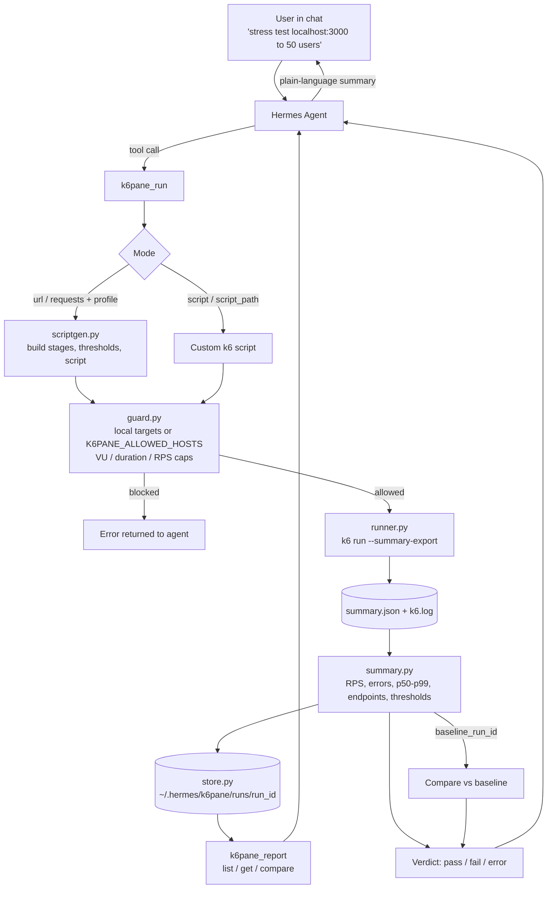

# k6pane

A [Hermes Agent](https://hermes-agent.nousresearch.com) plugin for running [k6](https://grafana.com/docs/k6/) load tests on your own machine. Ask Hermes to "stress test my login API up to 50 users and tell me if p95 stays under 300ms". k6pane writes the k6 script, runs it, parses the results, stores the run, and can diff it against an earlier run.

## Tools

| Tool | What it does |
|---|---|
| `k6pane_doctor` | Checks that k6 is installed (prints the install command if not), and shows the version, limits, allowed hosts and where runs are stored. |
| `k6pane_run` | Runs a test. It has two modes. **Structured mode** takes `url` or a multi-step `requests` flow plus a `profile` (`smoke`, `load`, `stress`, `spike`, `soak`, `constant`), or a fixed `rate` in iterations per second (each iteration runs the whole flow). **Custom mode** takes your own `script` or `script_path`. It returns the verdict, RPS, error rate, latency (p50/p90/p95/p99), a per-endpoint breakdown, threshold results and failed checks. `dry_run` only generates the script. |
| `k6pane_report` | `list` shows recent runs, `get` returns one run's full result, and `compare` diffs a run against a baseline and flags latency, RPS or error regressions. |

There is also a bundled skill (installed to `~/.hermes/skills/k6pane/SKILL.md` on first load). It teaches the agent the workflow: smoke test first, map the user's SLO to thresholds, report the bottleneck, and compare against a baseline.

## Install

```bash
brew install k6                     # or see https://grafana.com/docs/k6/latest/set-up/install-k6/
ln -s "$PWD" ~/.hermes/plugins/k6pane   # or clone this repo into ~/.hermes/plugins/k6pane
# or install as a package (Hermes discovers it via the hermes_agent.plugins entry point):
pip install git+https://github.com/fozagtx/k6pane
```

On newer Hermes versions plugins are opt-in, so also add `k6pane` under `plugins.enabled` in `~/.hermes/config.yaml`. Restart Hermes and run `/plugins`. You should see `k6pane` with 3 tools.

## Usage

Once installed, talk to Hermes normally (CLI, desktop, Telegram, Discord, any gateway):

```
Smoke test http://localhost:3000/health
Load test my API at localhost:8080: login then fetch /api/feed, 25 users for 2 minutes, p95 under 300ms
Stress test localhost:3000/search up to 100 users and tell me where it breaks
Can localhost:4000/api/orders handle 200 requests per second?
Rerun the last test and compare it to the baseline
```

A run returns a compact result the agent summarizes for you:

```json
{
  "run_id": "20261111-020614-e2e-3f1a",
  "verdict": "pass",
  "profile": "load",
  "summary": {
    "requests": 14820, "rps": 123.4, "error_rate": 0.0,
    "latency_ms": {"avg": 41.2, "p50": 37.0, "p90": 68.1, "p95": 84.6, "p99": 142.3, "max": 311.0},
    "endpoints": {"login": {"latency_ms": {"p95": 120.4}, "error_rate": 0.0}, "feed": {"latency_ms": {"p95": 62.8}, "error_rate": 0.0}},
    "thresholds": [{"metric": "http_req_duration", "threshold": "p(95)<300", "passed": true}]
  }
}
```

### How it works



1. **Script generation**: structured requests are turned into a k6 script. Your config is embedded as JSON, so URLs, headers and bodies can't inject JavaScript. Per-endpoint tags and sub-metric thresholds give a latency and error breakdown for each endpoint.
2. **Execution**: runs `k6 run --summary-export` locally with a timeout of the planned duration plus 60s. On timeout k6 gets SIGINT, so it still writes a summary.
3. **Parsing**: the k6 summary export is reduced to the numbers that matter, and each run gets a verdict with an `explanation`:
   - `pass`: all thresholds met under the requested load.
   - `fail`: the target crossed a threshold under the requested load.
   - `invalid`: the requested load was never actually applied, so the numbers don't answer the question. This happens when k6 dropped iterations, reached less than 95% of the target arrival rate, reported "Insufficient VUs", or the run hit the timeout. The `invalid_reasons` field says which. With arrival-rate tests, drops often mean `max_vus` is too low for the target's response time rather than a slow machine. Invalid runs can't be used as a comparison baseline.
   - `error`: the script or config is broken.
4. **Storage**: every run is kept under `~/.hermes/k6pane/runs/<run_id>/` so it can be compared with later runs.

### Project layout

```
__init__.py        Hermes directory-plugin shim (points at ./k6pane/)
plugin.yaml        Hermes manifest
pyproject.toml     packaging, pip entry point, pytest + ruff config
k6pane/
  plugin.py        register(ctx): wires tools, installs the skill
  schemas.py       tool schemas the model reads
  tools.py         handlers for k6pane_doctor / k6pane_run / k6pane_report
  scriptgen.py     spec to k6 script (profiles, stages, thresholds)
  runner.py        finds and runs the k6 binary
  summary.py       parses summary exports, compares runs
  guard.py         target allowlist and size limits
  store.py         run storage
  durations.py     k6 duration parsing
  skill.md         bundled Hermes skill
tests/             unit + end-to-end tests
```

## Safety and limits

k6pane is for load testing systems you run yourself.

- **Targets**: only hosts that resolve to loopback, private or link-local addresses are allowed by default. To test a remote host you own, add it to `K6PANE_ALLOWED_HOSTS` (comma separated, `*.staging.example.com` wildcards work) in `~/.hermes/.env`. The agent cannot change this list.
- **Size caps**: `K6PANE_MAX_VUS` (default 200), `K6PANE_MAX_DURATION` (default `30m`), `K6PANE_MAX_RPS` (default 2000; counted as `rate` × requests per iteration). A test over a limit is rejected, not silently shrunk.
- **IP fence**: each target host is resolved once and validated, and k6 is then started with `--blacklist-ip` covering every address except those exact IPs. k6 checks the address it actually connects to, so this one fence blocks:
  - redirects from an allowed host to any other host,
  - DNS rebinding between validation and execution,
  - IP literals, and
  - custom scripts that build URLs at runtime.

  Hosts that don't resolve are refused. An allowlisted remote host is pinned to the IPs it resolved to at validation time, so a CDN that rotates addresses mid-test will see blocked connections.
- **Custom scripts**: targets come from the URLs found in the script and in `env` values. Anything else the script tries to reach is blocked by the fence. If no URL is found, every connection is blocked and k6pane says so. VU caps only apply to the `vus` you pass, not to options defined inside your script.

## Credentials

Never put tokens in chat or in tool calls. Store each one once in `~/.hermes/.env`:

```bash
K6PANE_SECRET_API_TOKEN=eyJhbGciOi...
```

Then reference it by name: `"Authorization": "Bearer ${secret.API_TOKEN}"` in structured mode (URL path or query, headers, bodies), or `await secrets.get('API_TOKEN')` in a custom script with `"secrets": ["API_TOKEN"]`.

- Only `K6PANE_SECRET_*` variables can be referenced, so the agent cannot read your other environment variables through a placeholder.
- Values reach k6 through an inherited pipe (`--secret-source=file=/dev/fd/N`). They never touch disk or the command line, and k6 redacts them from its own logs.
- Stored scripts keep the placeholder. Every file under `runs/<id>/` and every tool response goes through a redaction pass covering secret values, `Authorization`, `Cookie`, `Set-Cookie` and `Proxy-Authorization` headers, keys or query parameters matching `api_key|token|secret|password|passwd|bearer`, and literal values under those keys, which are moved into protected values automatically.
- k6 runs with a scrubbed environment (PATH, HOME, locale and temp variables plus the `env` you pass), so scripts can't read your API keys. `env` keys that look like credentials are rejected.
- Inline custom scripts containing a literal credential are rejected. A `script_path` file is yours, but its stored copy is redacted.
- Secrets require a POSIX system (macOS or Linux) and k6 with `k6/secrets` support.

## Other settings

| Variable | Default | Purpose |
|---|---|---|
| `K6PANE_HOME` | `~/.hermes/k6pane` | Where runs are stored (`runs/<run_id>/` holds `script.js`, `summary.json`, `k6.log`, `result.json`). |
| `K6PANE_K6_BIN` | `k6` on PATH, then Homebrew/system paths | Explicit path to the k6 binary. |

## Development

```bash
pip install -e ".[dev]"
ruff check .
pytest
```

CI (`.github/workflows/ci.yml`) runs lint and the full test suite on every push and pull request, with a real k6 installed. `K6PANE_REQUIRE_K6=1` makes the end-to-end tests fail rather than skip if k6 is missing, so they actually gate pull requests.

Unit tests cover duration parsing, target guards, profile shapes, script generation, summary parsing and comparison. The end-to-end tests start a local HTTP server and run real k6 tests; they're skipped if k6 isn't installed.

Tested against k6 v2.3.0 and Hermes Agent v0.7.0.

## License

MIT. See [LICENSE](LICENSE).
